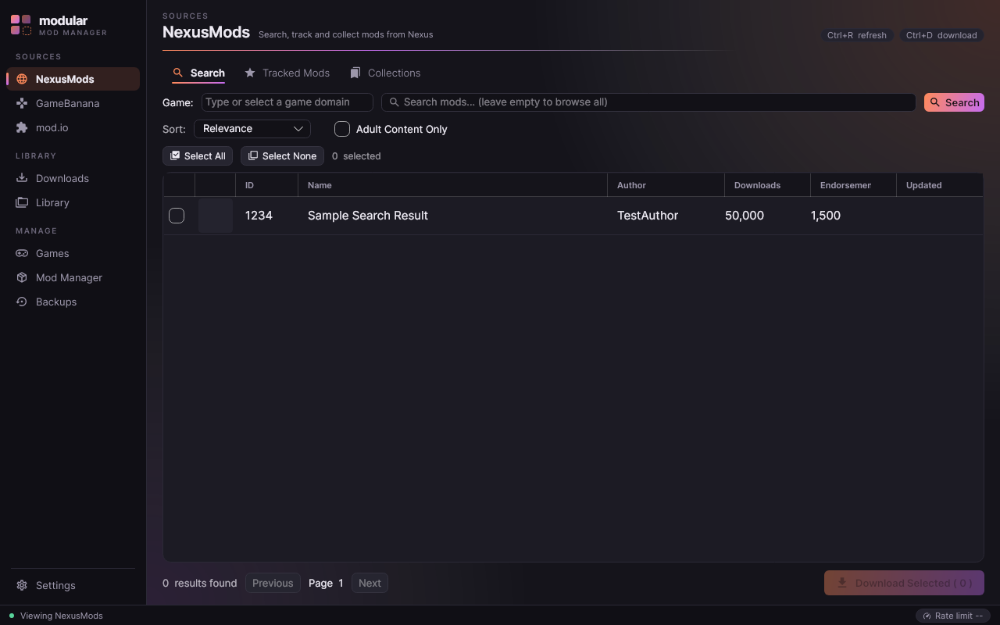
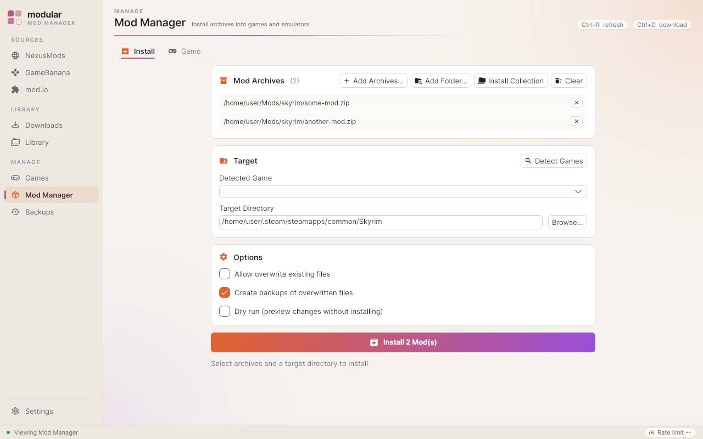

# GUI Design: "Ember"

The Avalonia GUI uses a compact theme called Ember. The accent runs from ember
orange to orchid, on an ink background in dark mode and a paper background in
light mode. All colours live in one place, so views never hard-code them.

| Dark | Light |
| --- | --- |
|  |  |

## Files

- `src/Modular.Gui/Themes/Palette.axaml`: colour tokens for the `Dark` and `Light` theme
  dictionaries, the gradients, and the compact Fluent metrics (13px body text, 32px tabs).
- `src/Modular.Gui/Themes/Modular.axaml`: shared style classes (below), the sidebar nav
  template, tab and data grid styling.
- `src/Modular.Gui/App.axaml`: `FluentTheme DensityStyle="Compact"` with a matching
  `ColorPaletteResources` per theme, so stock Fluent controls (checkboxes, selection,
  focus) pick up the palette too. It also registers `MaterialIconStyles`, which
  Material.Icons 2.x needs to draw any icon.

## Tokens

Use these with `{DynamicResource ...}` so light/dark switching from Settings keeps working.

| Brush | Use |
| --- | --- |
| `CanvasBrush`, `SidebarBrush` | Window and sidebar backgrounds |
| `SurfaceBrush`, `SurfaceRaisedBrush` | Cards; rows or tiles inside a card |
| `StrokeBrush`, `StrokeStrongBrush` | Hairlines and borders |
| `TextBrush`, `MutedBrush`, `FaintBrush` | Body text, secondary text, captions |
| `AccentBrush`, `AccentSoftBrush`, `AccentForegroundBrush` | Accent, tinted selection, text on accent |
| `AccentGradientBrush` | Primary buttons, badges, progress, tab underline |
| `SuccessBrush`, `WarningBrush`, `DangerBrush`, `InfoBrush` | Status (instead of `Green`, `Orange`, `Red`, ...) |

## Style classes

| Class | Element | Purpose |
| --- | --- | --- |
| `card` | `Border` | Section container (surface, 1px stroke, 10px radius, 14px padding) |
| `callout` | `Border` | Warning banner |
| `pill`, `badge` | `Border` | Small neutral chip; gradient count badge |
| `title`, `h2`, `eyebrow`, `caption`, `stat` | `TextBlock` | Page title, section heading, small-caps label, secondary line, large number |
| `glyph` | `MaterialIcon` | 16px accent icon next to an `h2` |
| `accent` | `Button` | Primary action, at most one or two per screen |
| `nav` (+ `active`) | `Button` | Sidebar entry with gradient indicator |

## Conventions

- Spacing follows a 4px rhythm: 10–12 between cards, 14 inside them, 6–8 between controls.
- A section header is `<mi:MaterialIcon Kind="..." Classes="glyph"/>` followed by
  `<TextBlock Text="..." Classes="h2"/>`.
- Each page's sidebar group and one-line caption come from `MainWindowViewModel.PageGroup` /
  `PageCaption`. Add an entry there when you add a page.
